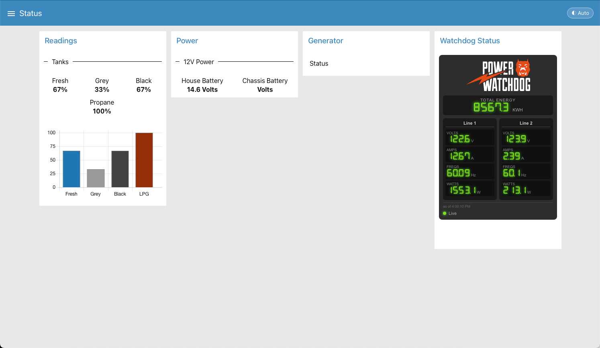

# Hughes Power Watchdog on your RV CoachProxy Dashboard

Reverse-engineered Bluetooth protocol and a live dashboard widget for the Hughes Autoformers Power Watchdog RV surge protector (Gen I). Enables integration with CoachProxy, Node-RED, Home Assistant, and other platforms without the proprietary app.

> Unofficial. Not affiliated with or endorsed by Hughes Autoformers. Use at your own risk. The software in this repository
> only **reads** from the Watchdog; it never sends it commands.



## What this does

It puts your Power Watchdog's live numbers (volts, amps, watts, frequency and total energy for each line, plus the unit's error code if it reports one) on your CoachProxy
dashboard. Your Watchdog can only talk to **one** phone or computer at a time, so the widget connects **only while someone is
looking at it** and lets go a few seconds after you leave. The rest of the time your phone and the Hughes app can use the
Watchdog as usual.

## Install on CoachProxy (about 5 minutes)

**You need:** a Hughes Power Watchdog (the Bluetooth "Gen I" model) that is plugged in, a CoachProxy on your Wi-Fi, SSH access
to it, and the Hughes app **closed** (swiped away) on every phone and tablet
(see [The Hughes app and the dashboard take turns](#the-hughes-app-and-the-dashboard-take-turns)).

### Step 1. SSH into your CoachProxy

From a computer on the same Wi-Fi (the IP address is on your dashboard under **System > Network Information**).

### Step 2. Paste one command

```
curl -fsSL https://raw.githubusercontent.com/schmiechen/power-watchdog/main/get.sh | bash
```

It checks your CoachProxy, finds your Watchdog over Bluetooth, takes one test reading, saves a backup of your dashboard
settings, and adds the widget to your **Status** tab. It explains each step in plain words as it goes ("Step 1 of 5" and so on)
and takes about a minute. **It worked if you see `All done.`** If you see `Stopped:` instead, read the
sentence after it, which says what to fix, and run the same command again (it is safe to repeat).

**Want to look first?** Download the installer, read it, then run it:

```
curl -fsSLO https://raw.githubusercontent.com/schmiechen/power-watchdog/main/get.sh
less get.sh        # read it; press q to quit
bash get.sh
```

Add `--dry-run` to either version to see what *would* happen without changing anything
(`bash get.sh --dry-run`, or `... | bash -s -- --dry-run`).

If it says it found **more than one** Watchdog (neighbors in a campground), it needs the **code printed on the label of your
Watchdog**; it looks like `APMDB7C41E9F2`. Run it again with your code: `bash get.sh --code APMDB7C41E9F2` (the download-first
version above) or `curl -fsSL https://raw.githubusercontent.com/schmiechen/power-watchdog/main/get.sh | bash -s -- --code APMDB7C41E9F2`.

### Step 3. Look at your dashboard

Open your CoachProxy dashboard in your browser as usual and go to the **Status** tab. Find the **Watchdog** panel (if you cannot
see it, refresh the page). Within a few seconds it should show **Live** and your numbers.

## What you will see on the dashboard

| Panel says | What it means |
|---|---|
| **Live** (green) | Connected. The numbers are current. |
| **Connecting...** | Reaching for the Watchdog. Takes a few seconds. |
| **Unavailable** (red), numbers in dim red | It could not reach the Watchdog, usually because the Hughes app (or another phone) has it. The dim red numbers are the **last readings it had, not current ones**. Close the other app, then press **Retry**. |
| **Paused** | It has been connected for an hour and let go so a forgotten wall tablet cannot hold your Watchdog. Press **Resume**. |

## The Hughes app and the dashboard take turns

The Watchdog accepts one Bluetooth connection at a time. While the Hughes app is open and connected, the dashboard shows
**Unavailable**; while the dashboard is showing live numbers, the Hughes app cannot find the Watchdog. This is how the Watchdog
works, not a fault. The dashboard lets go about 15 seconds after you switch tabs, close the page, or lock your phone.

On an iPhone or iPad, the Bluetooth button in Control Center does **not** fully switch Bluetooth off; use **Settings > Bluetooth**.

## If something does not work

**The installer says it cannot find the Watchdog.** Check it is plugged in and switched on, close the Hughes app on every phone and tablet,
and run the installer again. If you know the Watchdog's Bluetooth address you can give it directly:
`bash get.sh --mac AA:BB:CC:DD:EE:FF`.

**It finds more than one Watchdog.** Run it again with the code from your Watchdog's label (`--code`, see above). Matching on
the label code has been confirmed on one unit only.

**The panel says Unavailable.** Close the Hughes app on every phone and tablet, then press **Retry**.

**The panel stays on "Connecting...".** Refresh the page. If it keeps happening, run the installer again; it is safe to repeat.

**The installer says it could not use Node-RED.** It prints three short manual steps to follow instead.

**Anything else:** [open an issue](https://github.com/schmiechen/power-watchdog/issues) and include what the installer printed.

## Update, remove, or reinstall

- **Update** to a newer version: run the same install command again. It is safe to repeat, and it only touches its own pieces.
- **Remove:** run the install command with `--uninstall` added: `curl -fsSL https://raw.githubusercontent.com/schmiechen/power-watchdog/main/get.sh | bash -s -- --uninstall`.
- **If you re-flash your CoachProxy's SD card** the widget goes with it. Run the installer again.
- **Your backups** (a copy of your dashboard settings from before each change) are in `/coachproxy/backups/`.
- **If you used the first version of this project** (the one that polled every 15 seconds), the installer switches its old
  pieces off (it does not delete them).

What the installer changes and where is listed in [`docs/coachproxy.md`](docs/coachproxy.md).

---

# For other setups and for developers

## What's in here

| Piece | What it is | Needed for |
|---|---|---|
| [`docs/protocol.md`](docs/protocol.md) | The decoded Bluetooth protocol: GATT layout, packet format, error codes, commands to avoid | everyone |
| `power_watchdog_stream.py` | **On-demand live reader.** Start it and it prints one JSON reading per second; stop it and it disconnects cleanly | everyone |
| `power_watchdog_ble.py` | One-shot reader (one reading, then exit) plus the shared protocol helpers | polling-style use; required by the stream reader |
| `install_coachproxy.py`, `get.sh` | The installer described above (works on any machine that runs Node-RED with the classic dashboard) | the easy install |
| `nodered/` | Importable Node-RED flow with a dashboard widget that connects **only while someone is looking at it** | Node-RED users (optional) |
| [`docs/coachproxy.md`](docs/coachproxy.md) | What the installer does on CoachProxyOS, and how to do it by hand | CoachProxy users (optional) |
| [`docs/examples.md`](docs/examples.md) | Recipes for Home Assistant and other platforms (**untested examples**) | optional |

## What has been tested

| Item | Status |
|---|---|
| Reader (`power_watchdog_stream.py`) on a Raspberry Pi Zero W (Raspbian 10 "Buster", BlueZ 5.50, Python 3.7) with a real Gen I 50 A unit | **Verified**: live readings, clean disconnect (the unit advertises again about 2 s later), stops cleanly on SIGTERM |
| Reader unit tests (`python3 -m unittest discover -s tests`) | Pass on macOS and on the Pi; they replay 620 real recorded packets through a fake `gatttool` |
| Node-RED flow, server side (start/stop, grace period, shared viewers, unavailable handling, no orphan after a hard kill of Node-RED) | **Verified** in a fresh Node-RED 5.0.8 + node-red-dashboard 3.6.6; controller logic has its own tests (`node tests/test_controller.js`) |
| Widget behavior in real browsers on a real Pi (Node-RED 2.2.2, node-red-dashboard 2.19.2; desktop Chrome and a phone browser): open, tab switch, two viewers, phone lock, all pages closed, Hughes app holding the unit then released + Retry | **Verified** (one session; a longer soak is still pending) |
| One-command installer (`install_coachproxy.py`, `get.sh`) | **Verified** by unit tests, on a throwaway Node-RED 2.2.2 + dashboard 2.19.2 with simulated Bluetooth, and on a real CoachProxyOS Pi (dry run, uninstall, then a fresh install with a real Bluetooth scan and test reading, run from local files). Not yet tested: the one-line `curl` download from GitHub (the file is not on `main` until this is merged), and the path that creates a new Watchdog group on the Status tab (only unit-tested; the test Pi already had a group) |
| Fault / error codes | The reader and widget pass the unit's error code through and the widget shows it as the code the unit and the Hughes app show with the manual's meaning, such as `Error E7: Missing ground` (unit-tested with a simulated fault). **Never seen on a real unit**: all recorded readings are code 0, so the byte position is confirmed only by the vendor app's code. The E1 to E9 meanings match the Hughes manual; the F1/F2 (frequency) codes are not in the manual page we checked, so the widget shows them as the bare code. |
| Gen I 30 A (single line) | Expected to work (the widget hides the missing second line); **untested** |
| Home Assistant and other platforms | Examples only, **untested** |
| Not supported | Gen II / Wi-Fi Power Watchdogs; FlowFuse "Dashboard 2.0" (a different widget system); systems without `gatttool` |

## Manual install (any Linux machine with Node-RED)

Requirements: a Linux machine within Bluetooth range (about 30 ft) of the Watchdog with BlueZ's **`gatttool`**
(`sudo apt-get install bluez`; newer distributions have dropped it and are not supported yet), Python 3.7 or newer (standard
library only), `bluetoothd` left **running** (stopping it leaves the adapter unable to make LE connections), and, for the
widget, Node-RED 2.x or newer with the classic `node-red-dashboard` (no longer maintained upstream).

The installer works on any such machine, not just CoachProxy: `sudo python3 install_coachproxy.py --dir /opt/power-watchdog`
(use `--tab "Your Tab Name"` to choose the dashboard tab; `--help` lists the options). To do it entirely by hand:

```bash
git clone https://github.com/schmiechen/power-watchdog.git
cd power-watchdog
sudo ./install.sh              # copies the two Python files to /opt/power-watchdog (see --help)
sudo ./setup.sh                # finds your Watchdog and writes /etc/power_watchdog.conf
sudo python3 /opt/power-watchdog/power_watchdog_stream.py --once
```

The last command should print a connecting line and then one live reading, and exit. If it says `unavailable`, see
Troubleshooting below.

### Configuration

Searched in order: `/etc/power_watchdog.conf`, `/coachproxy/power_watchdog.conf`, `config.json` next to the script.

```json
{ "mac": "AA:BB:CC:DD:EE:FF", "cccd": "0x0021" }
```

Or pass the address on the command line: `python3 power_watchdog_stream.py AA:BB:CC:DD:EE:FF`.

## The live reader

```
python3 power_watchdog_stream.py [MAC] [--config PATH] [--once] [--max-seconds N] [--interval S]
                                 [--stop-on-stdin-eof] [--exit-with-parent]
                                 [--keepalive-file PATH [--keepalive-timeout S]] [-v]
```

It prints one JSON object per line:

```json
{"state":"connecting","attempt":1}
{"state":"live","timestamp":1790000000,"line1":{"voltage":122.4,"amps":0.7,"watts":52.4,"frequency":60.04,"energy_kwh":4680.6},"line2":{"voltage":123.3,"amps":2.12,"watts":173.3,"frequency":60.05,"energy_kwh":3853.1},"total_energy_kwh":8533.1,"error_code":0}
{"state":"unavailable","reason":"in_use_or_unreachable","detail":"connect error: Connection refused (111)"}
```

- `line2` is absent on single-line units. `error_code` is `0` when healthy (codes are listed in [`docs/protocol.md`](docs/protocol.md)).
- `reason` is one of `not_configured`, `adapter_not_ready`, `in_use_or_unreachable`, `no_data`.
- **Stopping it frees the Watchdog.** Send `SIGTERM` or `SIGINT`, use `--max-seconds N` or `--once`, run with
  `--stop-on-stdin-eof` and close its input, or run with `--keepalive-file PATH` and delete that file (or stop changing its
  content for `--keepalive-timeout` seconds). It disconnects cleanly in all of these cases.
- Exit codes: `0` stopped normally, `2` no device address configured, `3` unavailable after retrying.
- It makes at most two connection attempts, then gives up instead of retrying in a loop.

The older one-shot script is still there for polling-style use: `python3 power_watchdog_ble.py` prints a single reading.
If you poll, poll sparingly (the Watchdog accepts one connection, see above).

## Node-RED dashboard widget (import by hand)

1. Copy `power_watchdog_stream.py` and `power_watchdog_ble.py` to the machine running Node-RED (for example `/opt/power-watchdog`).
2. In Node-RED choose **Import** and paste `nodered/power_watchdog_flow.json`. It brings its own dashboard tab and group, so it
   imports anywhere; afterwards you can drag the *Watchdog Display* widget into any group on any tab.
3. Open the imported flow tab, double-click the tab name, and set its **Environment variables** (see below), at least `PW_DIR`.
4. Deploy, open the dashboard, and look at the widget.

**How it behaves.** The widget tells the flow when it is actually visible in a browser (on any tab). The first viewer starts the
reader; when the last viewer leaves (switches tab, hides the page, closes it, loses Wi-Fi), the connection is dropped after a
short grace period. The widget shows **Live**, **Connecting...**, **Unavailable** (with a plain-language reason and a **Retry**
button) or **Paused**; the last readings stay on screen, in dim red, while there is no live data.

| Variable | Default | Meaning |
|---|---|---|
| `PW_DIR` | `/opt/power-watchdog` | folder containing `power_watchdog_stream.py` |
| `PW_CONFIG` | (empty) | config file path, if not one of the default locations |
| `PW_LAUNCHER` | (empty) | set to `sudo` if `gatttool` needs root and Node-RED does not run as root (needs passwordless sudo) |
| `PW_ARGS` | (empty) | extra reader options, for example the device address |
| `PW_GRACE` | `15` | seconds to wait after the last viewer leaves before disconnecting |
| `PW_LEASE` | `15` | seconds a widget heartbeat stays valid (a vanished browser is released after this plus the grace) |
| `PW_CAP` | `3600` | longest continuous session in seconds; then it pauses ("Resume" to continue) |
| `PW_KEEPALIVE` | `/dev/shm/power-watchdog.keepalive` | small file the flow keeps refreshing while the reader should run; the reader stops by itself when it disappears |
| `PW_KA_TIMEOUT` | `15` | seconds without a refresh before the reader stops by itself |

**Why a keep-alive file?** A normal user may not signal a process owned by root. If the reader runs through `sudo`
(`PW_LAUNCHER=sudo`), a stop signal is silently refused and the Watchdog would stay connected. So the flow refreshes a small
file while the reader should run and **deletes it to stop it**; the reader exits by itself when the file disappears or stops
changing, and Node-RED then reports its exit. Signals are only a last resort after a few seconds of silence. (They are not
sent first on purpose: in Node-RED 2.x a refused signal makes the exec node forget the process, so its exit is never
reported.) The file also frees the Watchdog if Node-RED itself dies. It must be writable by the user Node-RED runs as and
readable by the reader; the default in `/dev/shm` is fine on Linux. If the controller cannot confirm the reader is gone, the
widget says so (`stop_failed`) instead of claiming the Watchdog is free, and it will not start a second reader meanwhile.

## Troubleshooting (technical)

**`adapter_not_ready` / "Function not implemented (38)":** make sure `bluetoothd` is running (`systemctl status bluetooth`) and
the adapter is up (`hciconfig`). Do not stop `bluetoothd`.

**`in_use_or_unreachable` (widget: "Watchdog not reachable"):** the Watchdog is switched off, out of range, or something else is
connected. Close the Hughes app on every phone and tablet. On iPhone/iPad use Settings > Bluetooth (Control Center does not
fully switch it off). Then press Retry.

**`no_data`:** the connection was made but no readings arrived. Try again; if it persists, power-cycle the Watchdog.

**Permission errors / nothing happens when started from Node-RED:** `gatttool` usually needs root. Set `PW_LAUNCHER=sudo`
(and allow passwordless sudo for the Node-RED user), or run Node-RED as a user that may use the adapter. The installer does
this for you.

**Raspberry Pi Zero W:** Wi-Fi and Bluetooth share one chip. If the Pi's Wi-Fi drops often, turn Wi-Fi power save off
(`sudo iw dev wlan0 set power_save off`; it does not persist across reboots by itself).

**"No PMD device found" during `setup.sh`:** the Watchdog must be on shore power and not connected to the Hughes app.

## Files

| File | Purpose |
|---|---|
| `power_watchdog_stream.py` | On-demand live reader (JSON lines) |
| `power_watchdog_ble.py` | One-shot reader and shared protocol helpers |
| `install_coachproxy.py`, `get.sh` | One-command installer and its small downloader |
| `install.sh` | Copies just the Python files into place |
| `setup.sh` | Finds the device, discovers its handles, writes the config |
| `config.json.example` | Config template |
| `nodered/power_watchdog_flow.json` | Importable Node-RED flow and dashboard widget (generated by `tools/build_flow.py` from `nodered/src/`) |
| `tests/` | Unit tests (`python3 -m unittest discover -s tests`, `node tests/test_controller.js`) |
| `docs/` | Protocol notes, CoachProxy notes, examples |
| `watchdog_gatttool.py`, `watchdog.js` | Early prototypes, kept for reference |

## How this was reverse-engineered

1. Captured Bluetooth traffic with a BLE explorer and a GATT dump of a real unit.
2. Identified the UART-style service (`0xFFE0`) and its characteristics.
3. Decompiled the vendor's Android app (`com.hughes.epo`) and read its scan/connect/command code
   (`BluetoothService`, `BluetoothHandle.getPowerWatchdogData()`, `Util.byte4ToDouble()`).
4. Confirmed the behavior against packet captures of the iOS app talking to a real unit.

## License

MIT. See [`LICENSE`](LICENSE).
